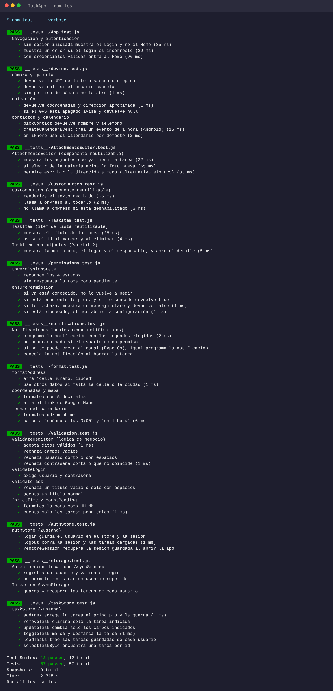

# ✅ TaskApp – Gestor de Tareas (React Native + Expo)

Trabajo práctico individual de React Native – Istea.
**Alumno:** Bruno Castillo

## Tema elegido

**✅ Gestor de tareas.** Cada tarea tiene título, recordatorio por notificación y, desde el Parcial 2, **foto**, **lugar** (GPS), **responsable** (contacto del celular) y **evento en el calendario**.

## 🎬 Videos demo

- ▶️ **Parcial 2:** [Ver demo en YouTube](https://youtu.be/REEMPLAZAR_CON_LINK_PARCIAL_2)
- ▶️ Parcial 1: [Ver demo en YouTube](https://youtube.com/shorts/OYGY6Do-X_E)

---

## 🆕 Parcial 2 – Recursos del dispositivo y estado global

| Requisito | Cómo se cumple |
|---|---|
| **Permisos** | Cada permiso se pide **recién cuando se usa** el recurso (`src/services/permissions.js`). Se manejan los estados **concedido**, **denegado**, **pendiente** y **bloqueado** (denegado sin poder volver a preguntar). Si el usuario lo rechaza, aparece un **mensaje claro** con una alternativa; si está bloqueado, un botón **Abrir configuración**. La pantalla **🔒 Permisos** muestra el estado de cada uno. |
| **Cámara y galería** | `expo-image-picker`: **sacar una foto** (`launchCameraAsync`) o **elegirla de la galería** (`launchImageLibraryAsync`). La foto queda asociada a la tarea y se ve como **miniatura en la lista** y grande en el **detalle**. |
| **Ubicación (GPS)** | `expo-location`: obtiene la ubicación actual, la convierte en **dirección aproximada** (`reverseGeocodeAsync`) y la guarda como el **lugar de la tarea**. Se muestran la dirección, las **coordenadas** y un link **Ver en el mapa** (Google Maps). |
| **Contactos** | `expo-contacts`: abre la agenda del celular para elegir al **responsable** de la tarea (nombre y teléfono, con link para llamar). |
| **Calendario** | `expo-calendar`: crea un **evento** en el calendario del celular ("En 1 hora", "Mañana 9:00" o "En 3 días") con aviso 15 minutos antes. Si se borra la tarea, también se borra el evento. |
| **Alternativas si se niega un permiso** | Cámara → galería · Ubicación → **escribir la dirección a mano** · Contactos → **escribir el nombre a mano** · Calendario → la tarea se guarda igual. |
| **Estado global (Zustand)** | `src/stores/taskStore.js` (lista de tareas con `addTask`, `removeTask`, `updateTask`, `toggleTask`, `loadTasks`) y `src/stores/authStore.js` (usuario logueado, `login`, `logout`, `restoreSession`). Reemplazan al `AuthContext` y a los `useState` de las pantallas: los componentes leen y modifican el estado con **selectores**, por ejemplo `useTaskStore(s => s.tasks)`. Cada acción guarda en AsyncStorage, así los datos siguen al cerrar la app. |
| **Testing** | **57 tests en 12 archivos** (Jest + React Native Testing Library), todos con `npm test`. |

### Pantallas nuevas

- **Detalle de la tarea** (tocar una tarea en la lista): foto, lugar, responsable y evento; se pueden **agregar o cambiar** desde ahí (usa `updateTask` del store).
- **🔒 Permisos** (desde el Home): estado de cada permiso y botón para pedirlo.

### ¿Por qué Zustand y no Redux Toolkit?

Como dice la Unidad 10: *"Comenzá con Zustand"*. Es una app mediana, de una sola persona, y Zustand necesita mucho menos código (no hace falta Provider ni slices). Además, los stores se testean directo con `getState()` / `setState()`, sin renderizar nada.

---

## Parcial 1 – Funcionalidades base

| Requisito | Cómo se cumple |
|---|---|
| **Componentes y estilos** | `View`, `Text`, `TextInput`, `Button`, `TouchableOpacity`, `FlatList`, `Image`. Todos los estilos con `StyleSheet`. |
| **Componentes reutilizables** | `CustomButton`, `TaskItem`, `FormInput`, `SectionCard` y `AttachmentsEditor` (se usa en *Nueva tarea* y en *Detalle*). |
| **Navegación (Stack)** | React Navigation *Native Stack*: **Login → Registro → Home → Nueva tarea → Detalle → Permisos**. |
| **Autenticación local** | Registro y login con usuarios guardados en AsyncStorage. Las pantallas internas **solo existen si hay sesión iniciada**. |
| **Persistencia** | Usuarios, sesión y tareas (con sus adjuntos) de **cada usuario por separado** en AsyncStorage. |
| **Notificación local** | `expo-notifications` (sin Firebase): aviso “⏰ Tarea pendiente” a los 5 seg, 10 seg, 1 min, 5 min o 30 min. |

---

## 🧪 Tests (`__tests__/`)

| Archivo | Qué prueba |
|---|---|
| `taskStore.test.js` | **Store de Zustand**: agregar, eliminar, actualizar y marcar tareas; carga por usuario. |
| `authStore.test.js` | **Store de Zustand**: login, logout (vacía las tareas) y recuperar la sesión. |
| `permissions.test.js` | Los **4 estados de permiso**, pedirlo solo si hace falta, mensaje si se rechaza y botón a configuración si está bloqueado. |
| `device.test.js` | Cámara/galería (y cancelar), ubicación con dirección, GPS apagado, contacto y evento del calendario (Android y iPhone). |
| `AttachmentsEditor.test.js` | **Componente reutilizable**: muestra los adjuntos, elegir de la galería y escribir la dirección a mano. |
| `format.test.js` | **Lógica**: dirección, coordenadas, link al mapa y fechas del calendario. |
| `CustomButton.test.js`, `TaskItem.test.js` | Componentes reutilizables (incluye miniatura y datos nuevos de la tarea). |
| `validation.test.js`, `storage.test.js`, `notifications.test.js`, `App.test.js` | Tests del Parcial 1: validaciones, AsyncStorage, notificaciones y flujo de login. |

Como en los tests no hay un celular, las librerías del dispositivo se simulan con **mocks** en `jest.setup.js`.

### ✅ Evidencia: tests pasando



---

## Cómo ejecutar la app

### Opción A – Expo Go

Requisitos: Node.js 20 o superior y la app **Expo Go** en el celular.

```bash
git clone https://github.com/bruno-istea/TaskApp.git
cd TaskApp
npm install
npx expo start
```

Escaneá el código QR con Expo Go. El celular y la compu tienen que estar en la misma red Wi-Fi; si no conecta, usá `npx expo start --tunnel`.

### Opción B – APK (Android, sin computadora)

El repo compila el APK automáticamente con GitHub Actions (`.github/workflows/build-apk.yml`) cada vez que se sube código a `main`.

1. Entrá desde el celular a la sección **Releases** del repositorio.
2. Descargá **app-release.apk** del último build.
3. Abrilo y permití **instalar apps de origen desconocido** si Android lo pide.

### Correr los tests

```bash
npm test
```

### Probar las funciones nuevas

1. Iniciá sesión y tocá **+ Nueva tarea**.
2. **Foto:** tocá *Cámara* o *Galería*.
3. **Lugar:** tocá *Usar mi ubicación actual* (o escribí la dirección a mano).
4. **Responsable:** tocá *Elegir de mis contactos*.
5. **Calendario:** elegí una fecha y tocá *Agregar al calendario*.
6. Guardá: la tarea aparece con su miniatura, lugar y responsable. Tocala para ver el **detalle**.
7. Para ver qué pasa al **rechazar un permiso**, negalo cuando la app lo pida, o revisá **🔒 Permisos** en el Home.

> Conviene probar en un **celular real**: los emuladores no simulan bien los permisos ni las notificaciones.

## Estructura del proyecto

```
App.js                           # Navegación (Stack) + protección de pantallas
src/
├── stores/                      # Estado global con Zustand
│   ├── authStore.js             #   usuario logueado (login / logout)
│   └── taskStore.js             #   lista de tareas (agregar / eliminar / actualizar)
├── components/                  # CustomButton, TaskItem, FormInput, SectionCard, AttachmentsEditor
├── screens/                     # Login, Register, Home, AddTask, TaskDetail, Permissions
├── services/
│   ├── permissions.js           # Flujo de permisos y sus estados
│   ├── device.js                # Cámara, galería, ubicación, contactos y calendario
│   ├── notifications.js         # Notificaciones locales
│   └── localNotificationsApi.js # Solo la parte local de expo-notifications (Expo Go)
├── storage/storage.js           # AsyncStorage: usuarios, sesión y tareas
├── utils/                       # validation.js y format.js (funciones puras, testeadas)
└── theme.js                     # Colores
__tests__/                       # Tests con Jest + RNTL
```

## Tecnologías

Expo SDK 57 · React Native · React Navigation 7 · **Zustand** · AsyncStorage · expo-notifications · **expo-image-picker** · **expo-location** · **expo-contacts** · **expo-calendar** · Jest (jest-expo) · React Native Testing Library

> Nota: según la consigna no hay backend y las contraseñas se guardan sin cifrar en AsyncStorage.
